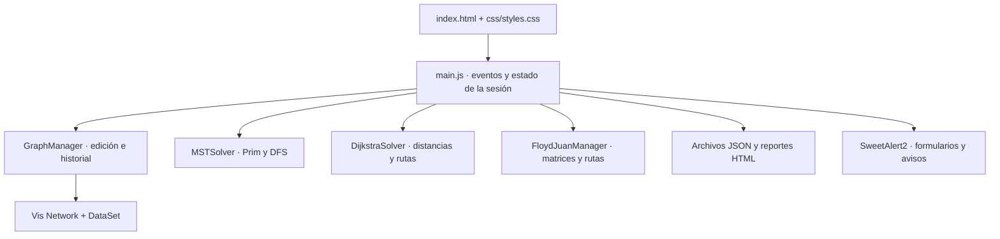

# OptiGraph Studio

**Editor visual de redes y herramienta educativa para estudiar Prim, Dijkstra y Floyd-Warshall en el navegador.**


OptiGraph Studio permite construir grafos ponderados, resolver problemas de Investigación de Operaciones y revisar cómo cambia la solución en cada iteración. Está orientado al aprendizaje: conecta la representación visual de una red con los conjuntos de Prim, las relajaciones de Dijkstra y las matrices de Floyd-Warshall.

Todo el cálculo y la edición se ejecutan en el cliente. La aplicación utiliza HTML, CSS y JavaScript, sin backend, base de datos ni proceso de compilación.

## Estado y alcance

- **Implementado:** editor de grafos, Prim, Dijkstra, Floyd-Warshall, ejemplos, generación de redes, historial, importación y exportación JSON y reportes HTML.
- **Pendiente en la interfaz:** Taller 3, Flujo Máximo. Su botón está deshabilitado y no hay un solver implementado.
- **Validación actual:** no se incluyen pruebas automatizadas, configuración de CI ni evidencia suficiente para declarar el proyecto listo para producción. Consulta las [limitaciones conocidas](#limitaciones-conocidas).
- **Demostración y capturas:** no hay una URL de demo documentada ni capturas incluidas en el repositorio. La aplicación puede ejecutarse localmente con los pasos de esta guía.

## Funcionalidades

### Edición y generación de redes

- Agregar nodos desde el lienzo, arrastrarlos y utilizar zoom y desplazamiento.
- Crear conexiones con peso positivo y elegir entre arco dirigido o conexión bidireccional.
- Cambiar pesos y eliminar aristas o nodos con sus conexiones mediante clic derecho.
- Cargar cuatro ejemplos: Red 1 y Red 2 de clase, Red 3 de 15 nodos y Red 4 de Floyd con 8 nodos y arcos dirigidos.
- Crear redes sin conexiones o generar redes aleatorias de **2 a 50 nodos**.
- Configurar la probabilidad de conexiones adicionales entre **0 % y 100 %** y el peso máximo entero entre **1 y 999**. La generación aleatoria crea primero un árbol base no dirigido para garantizar conexidad; el porcentaje no representa una densidad final exacta.
- Deshacer y rehacer operaciones de edición, cargas, importaciones y generación mediante snapshots en memoria.

El diseño incluye paneles plegables y reglas de adaptación para pantallas de hasta 1100 y 640 píxeles. La edición contextual utiliza clic derecho; no se ha establecido una cobertura de pruebas en dispositivos táctiles.

### Árbol de Expansión Mínima: Prim

Encuentra un conjunto de aristas que conecta todos los nodos con el menor peso total y sin ciclos, sobre una red conexa interpretada como no dirigida.

1. Comprueba la conexidad mediante búsqueda en profundidad (DFS).
2. Inicializa el conjunto visitado `C_k` con el nodo seleccionado y deja los restantes en `C̄_k`.
3. Examina las aristas que cruzan la frontera entre ambos conjuntos y elige la de menor peso.
4. Si hay empate, selecciona la primera candidata según el orden de las aristas y registra las demás como alternativas de esa iteración.
5. Incorpora el nuevo nodo, acumula el costo y repite hasta cubrir la red.

El resultado incluye peso total, aristas elegidas y bitácora por iteración. El AEM se resalta en verde; las alternativas empatadas que no pertenecen al árbol final aparecen en azul discontinuo. El contador de empates acumula alternativas registradas y puede contar una misma arista en varios pasos; no enumera todos los AEM posibles.

### Rutas mínimas: Dijkstra

Ofrece dos modos sobre la red interpretada como **no dirigida**, con pesos estrictamente positivos:

- **Origen a destino:** reconstruye una ruta mínima y se detiene al procesar el destino. Las distancias de otros nodos pueden quedar provisionales.
- **Origen a todos:** calcula distancias hacia todos los nodos alcanzables desde el origen.

Registra distancias, predecesores, iteraciones de permanencia, relajaciones y empates de distancia. La notación lateral `[distancia, predecesor]_(k)` acompaña a los nodos. La ruta se resalta en naranja, los nodos procesados en amarillo y las aristas relajadas en azul.

No exige conexidad: los nodos inalcanzables conservan distancia `Infinity` durante el cálculo.

### Rutas entre todos los pares: Floyd-Warshall

Calcula las distancias mínimas entre todos los pares de nodos y **respeta las conexiones dirigidas y bidireccionales**. La implementación exige pesos estrictamente positivos, aunque otras variantes del algoritmo admitan pesos negativos.

- Construye las matrices iniciales de distancias `D^(0)` y recorridos `P^(0)`.
- Ejecuta los tres bucles `k`, `i`, `j` y conserva las matrices de cada iteración.
- Muestra el pivote y las celdas que mejoran su distancia.
- Reconstruye recursivamente una ruta entre el origen y el destino consultados y la resalta en el grafo.
- Representa los pares inalcanzables con `Infinity` en memoria y `∞` en la vista de un cálculo nuevo.

La matriz `P` utiliza una convención de **pivotes intermedios**: inicialmente contiene la etiqueta del destino fuera de la diagonal y `-` en la diagonal; una mejora guarda la etiqueta del pivote. No representa siempre el predecesor inmediato. En este modo, el indicador del footer rotulado «Empates» muestra el total de mejoras de distancia.

> **Dirección de las conexiones:** el editor permite dibujar flechas en cualquier modo, pero únicamente Floyd las considera al calcular. Para Prim y Dijkstra, utiliza redes no dirigidas e interpreta sus conexiones en ambos sentidos.

## Tecnologías y decisiones técnicas

- **HTML5 y CSS3:** estructura semántica, tema visual, paneles, modales y reglas responsive propias.
- **JavaScript ES6+:** clases, `Map`, `Set`, promesas y APIs del navegador para interacción, cálculo y descargas. Los solvers reciben arreglos simples y no dependen del DOM.
- **Vis Network, distribución standalone UMD:** renderiza el grafo mediante `vis.Network` y administra nodos y aristas mediante `vis.DataSet`. La física está desactivada para mantener el posicionamiento manual.
- **SweetAlert2:** formularios, confirmaciones y notificaciones. La URL fija únicamente la versión mayor **11** mediante `sweetalert2@11`.
- **Tailwind CSS desde CDN:** clases utilitarias que complementan [los estilos propios](css/styles.css).
- **JSON y APIs `Blob` / `URL.createObjectURL`:** intercambio de redes y resultados mediante archivos descargables, sin persistencia en servidor.

Las dependencias externas se declaran en [index.html](index.html). Las URLs de Tailwind CSS y Vis Network no fijan una versión; la versión exacta de estas librerías y la versión menor/parche de SweetAlert2 no quedan registradas. No hay `package.json`, lockfile ni instalación con npm. El parámetro `?v=2` de los scripts locales es un parámetro de URL, no una versión de JavaScript ni de las dependencias.

## Arquitectura y organización

La aplicación separa la interfaz, la coordinación de eventos, la gestión visual del grafo y los motores de cálculo. Utiliza scripts clásicos cargados en orden, sin módulos ES ni bundler.



`main.js` toma nodos y aristas de `GraphManager`, invoca el solver activo y entrega el resultado a la visualización. También controla las métricas, el procedimiento y las descargas. Los algoritmos no manipulan el DOM ni los `DataSet`.

```text
optigraph-studio/
├── index.html                 # Interfaz y carga de scripts/CDN
├── css/
│   └── styles.css             # Tema, paneles y adaptación de pantalla
├── js/
│   ├── main.js                # Eventos, selección de algoritmo y reportes
│   ├── graph-manager.js       # Grafo visual, edición, presets e historial
│   ├── mst-algorithm.js       # Prim, conexidad y empates
│   ├── dijkstra-algorithm.js  # Distancias, relajaciones y rutas
│   └── floyd-algorithm.js     # Matrices, pivotes y reconstrucción recursiva
├── docs/                      # Documentación técnica por archivo
└── README.md
```

## Requisitos y ejecución local

Necesitas un navegador moderno con JavaScript y conexión a Internet para cargar las tres dependencias desde CDN. Para el servidor HTTP del ejemplo se requiere **Python 3**. Git solo es necesario si vas a clonar el repositorio.

### 1. Obtener el proyecto

```powershell
git clone https://github.com/Fede17-9/optigraph-studio.git
cd optigraph-studio
```

Si ya tienes el repositorio, abre una terminal en la carpeta que contiene `index.html`.

### 2. Iniciar el servidor estático

```powershell
python -m http.server 8000 --bind 127.0.0.1
```

En Windows, si tu instalación de Python utiliza el lanzador `py`, puedes usar:

```powershell
py -3 -m http.server 8000 --bind 127.0.0.1
```

Abre [http://127.0.0.1:8000/index.html](http://127.0.0.1:8000/index.html). Detén el servidor con `Ctrl+C`.

También puedes abrir `index.html` directamente, ya que utiliza scripts clásicos. Un servidor HTTP local facilita revisar las solicitudes de recursos y reproducir las condiciones de un alojamiento estático. No se necesita compilar ni instalar paquetes del proyecto.

### Configuración, autenticación y almacenamiento

No se requieren variables de entorno, archivo `.env`, credenciales, migraciones ni configuración de base de datos. No hay autenticación ni cuentas de usuario.

La red, el historial y el último resultado viven en memoria durante la sesión. No hay guardado automático en `localStorage` ni `sessionStorage`: **exporta tu trabajo antes de recargar o cerrar la página**.

## Guía de uso

1. Selecciona un ejemplo o crea una red vacía o aleatoria.
2. Para editar, usa **Agregar Nodo** y haz clic en el lienzo, o **Conectar Arco** y selecciona sus dos extremos. Introduce un peso positivo y la dirección.
3. Selecciona **Taller 1: AEM**, **Taller 2: Dijkstra** o **Floyd (Juan)**.
4. Pulsa **Resolver**. Prim solicita el nodo inicial; Dijkstra solicita el origen y, si corresponde, el destino; Floyd calcula las matrices y permite consultar pares de nodos.
5. Revisa el procedimiento, el resaltado y las métricas. Cambiar de algoritmo limpia la visualización del resultado anterior.
6. Después de modificar nodos, conexiones o pesos, **vuelve a resolver antes de consultar o exportar resultados**.
7. Exporta la red editable, la solución o el reporte. **Restablecer** limpia la visualización y el resultado activo sin borrar la estructura de la red.

## Importación, exportación y reportes

- **Exportar red:** descarga `optigraph-red.json`, con `version: 1`, `exportedAt`, `nodes` y `edges`. Incluye las propiedades almacenadas de los nodos y las conexiones, como etiquetas, coordenadas, pesos y dirección.
- **Exportar resultado:** descarga `optigraph-aem.json`, `optigraph-dijkstra.json` u `optigraph-floyd.json`. El documento usa `version: 2` e incluye `algorithm`, `exportedAt`, `graph` y `result`.
- **Importar:** acepta una red con `nodes` y `edges` en la raíz o un documento con `graph` y `result`. Si hay un resultado, intenta restaurar su vista según el algoritmo.
- **Reporte:** genera un HTML independiente con el resumen y el procedimiento del algoritmo activo. Ábrelo en un navegador e imprímelo; guardar como PDF depende de las opciones del navegador. La aplicación no genera PDF directamente.

Ejemplo mínimo de red importable:

```json
{
  "version": 1,
  "nodes": [
    { "id": "A", "label": "A", "x": -100, "y": 0 },
    { "id": "B", "label": "B", "x": 100, "y": 0 }
  ],
  "edges": [
    { "id": "A-B", "from": "A", "to": "B", "weight": 5, "directed": false }
  ]
}
```

El importador comprueba la presencia de los arreglos, IDs de nodos no repetidos, referencias a extremos existentes y pesos finitos mayores que cero. Convierte los pesos importados a números, pero no valida de forma completa el resultado adjunto, la versión del documento ni todas las propiedades de nodos y aristas. Utiliza IDs de texto consistentes y etiquetas únicas, especialmente para consultar rutas de Floyd.

## Pruebas y validaciones

El repositorio no incluye una suite de pruebas unitarias, de integración o de interfaz, ni comandos `npm test`, linting o cobertura. La separación de los solvers permite probarlos con datos simples sin iniciar Vis Network.

Como comprobación estática opcional, con Node.js instalado:

```powershell
node --check js/mst-algorithm.js
node --check js/dijkstra-algorithm.js
node --check js/floyd-algorithm.js
node --check js/graph-manager.js
node --check js/main.js
```

Estos comandos verifican sintaxis; no demuestran la corrección de los algoritmos ni el funcionamiento de la interfaz.

Para una revisión manual reproducible, se recomienda:

1. Importar la red mínima anterior: Prim debe producir peso total 5; Dijkstra de A a B, distancia 5; Floyd, distancia 5 en ambos sentidos.
2. Crear dos nodos sin conexión: Prim debe rechazar la red; Dijkstra debe conservar distancias inalcanzables; Floyd debe señalar que no existe camino al consultar el par.
3. Importar un peso cero o negativo y comprobar el rechazo; probar también los límites de los formularios de generación.
4. Crear aristas de igual peso para inspeccionar los empates de Prim y su procedimiento.
5. Exportar e importar una red y un resultado de cada algoritmo, revisar el HTML de reporte y comprobar Deshacer/Rehacer.
6. Revisar escritorio y pantallas pequeñas, incluidos paneles plegables, etiquetas y desplazamiento de las matrices.

Esta lista es una guía de verificación, no una declaración de que todos esos flujos cuentan con pruebas automatizadas o validación de navegador.

## Despliegue

La aplicación puede servirse como contenido estático publicando `index.html`, `css/` y `js/` y conservando sus rutas relativas. No hay un comando de build ni un servidor de aplicación que desplegar.

El repositorio no contiene configuración de hosting, contenedores ni pipelines de despliegue, y no documenta una URL pública de demostración. Para añadir una demo verificable, primero publica esos archivos en un alojamiento estático, comprueba la carga de las dependencias y registra aquí la URL resultante.

## Limitaciones conocidas

- **Seguridad de la importación:** algunos campos importados se interpolan en HTML sin escape y el resultado adjunto no se valida completamente. Importa únicamente archivos de confianza; no existe una garantía de procesamiento seguro de JSON ajeno.
- **Resultados desactualizados:** la edición manual no invalida automáticamente el último cálculo ni la instancia de Floyd. Vuelve a resolver después de modificar la red y antes de exportar.
- **Serialización de infinitos:** `JSON.stringify` convierte `Infinity` en `null`. No hay conversión inversa al importar resultados; esto afecta a nodos inalcanzables y también a estados intermedios con distancias aún desconocidas.
- **Identificadores:** la creación manual usa la cantidad de nodos para generar el ID y puede repetirlo después de eliminar nodos. La interfaz devuelve IDs de selectores como texto; los IDs numéricos importados pueden no coincidir con los que esperan los solvers. Floyd depende de etiquetas únicas para reconstruir rutas.
- **Posiciones:** el arrastre visual no sincroniza explícitamente las coordenadas del `DataSet`; una exportación no garantiza conservar la última posición arrastrada. El historial tampoco registra cada movimiento del lienzo.
- **Modelo del grafo:** Prim y Dijkstra tratan todas las conexiones como bidireccionales. La reconstrucción de aristas en presencia de conexiones paralelas no garantiza seleccionar la de menor peso; utiliza una sola conexión por par para estos modos.
- **Dependencias y escala:** se necesita acceso a CDN y no hay versiones exactas fijadas para reproducir todas las dependencias. Floyd conserva y renderiza matrices de cada iteración; no se incluyen mediciones de rendimiento ni garantías para redes grandes.

### Mejoras futuras

Flujo Máximo es el módulo pendiente visible en la interfaz. Como prioridades técnicas propuestas, sujetas a implementación: añadir pruebas de los solvers y de importación/exportación, validar y escapar datos externos, invalidar cálculos al editar, preservar infinitos en JSON, generar IDs únicos, sincronizar posiciones y fijar versiones de dependencias. Estas mejoras no se presentan como funcionalidades terminadas ni como un calendario comprometido.

## Documentación técnica

- [Interfaz y carga de scripts: `index.html`](docs/README-index.md).
- [Tema visual y responsive: `css/styles.css`](docs/README-styles.md).
- [Orquestación, eventos y reportes: `js/main.js`](docs/README-main.md).
- [Edición, presets e historial: `js/graph-manager.js`](docs/README-graph-manager.md).
- [Prim y conexidad: `js/mst-algorithm.js`](docs/README-mst-algorithm.md).
- [Dijkstra y reconstrucción de rutas: `js/dijkstra-algorithm.js`](docs/README-dijkstra-algorithm.md).
- [Floyd-Warshall y matrices: `js/floyd-algorithm.js`](docs/README-floyd-algorithm.md).

Para mantener la separación de responsabilidades, los cambios de interacción se coordinan desde `main.js`, la gestión visual se concentra en `GraphManager` y los cálculos permanecen independientes del DOM. Conviene documentar contratos con JSDoc, validar los datos y revisar los flujos de escritorio y móvil al cambiar la interfaz.

## Autor

[Juan Federico · Fede17-9](https://github.com/Fede17-9). Estudiante de Ingeniería de Sistemas y Computación y Tecnólogo en Análisis y Desarrollo de Software.

[Repositorio en GitHub](https://github.com/Fede17-9/optigraph-studio).
